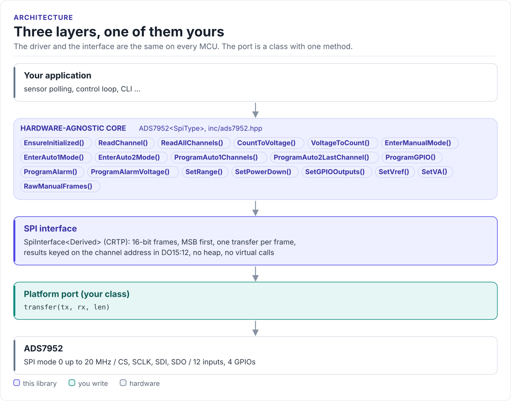

# ADS7952 Driver

A C++20 driver for the Texas Instruments ADS7952 12-channel, 12-bit, 1 MSPS SAR ADC: read one channel or a whole
sequence, program alarms and GPIOs, and convert counts to volts, from any MCU with SPI.

[](https://github.com/hardfoc/hf-ads7952-driver/actions/workflows/ci-host-tests.yml)
[](https://github.com/hardfoc/hf-ads7952-driver/actions/workflows/esp32-examples-build-ci.yml)
[](https://hardfoc.github.io/hf-ads7952-driver/)
[](LICENSE)

**Documentation: <https://hardfoc.github.io/hf-ads7952-driver/>**

<!-- figure: driver-layers -->
<picture>
  <source media="(prefers-color-scheme: dark)" srcset="docs/diagrams/driver-layers.dark.svg">
  
</picture>
<!-- /figure -->

## In 30 seconds

Write a one-method port class for your MCU (a 2-byte SPI transfer with CS held low;
[Porting](https://hardfoc.github.io/hf-ads7952-driver/latest/porting/)), then:

<!-- generated: quickstart-code -->
```cpp
#include "ads7952.hpp"
#include <cstdio>

int read_adc(MySpi& spi) {
  ads7952::ADS7952<MySpi> adc(spi, 2.5f, 5.0f);               // REFP = 2.5 V, +VA = 5 V

  if (!adc.EnsureInitialized()) {                             // 1. discard power-up frame, program sequences
    return -1;
  }

  const ads7952::ReadResult ch3 = adc.ReadChannel(3);         // 2. one channel (Manual mode)
  if (!ch3.ok()) {
    return -1;                                                // Timeout: wiring, SPI mode or CS framing
  }
  std::printf("CH3 = %.3f V (%u counts)\n", ch3.voltage, static_cast<unsigned>(ch3.count));

  const ads7952::ChannelReadings all = adc.ReadAllChannels(); // 3. every channel (Auto-1 mode)
  for (uint8_t ch = 0; ch < 12; ++ch) {
    if (all.hasChannel(ch)) {
      std::printf("CH%u = %.3f V\n", static_cast<unsigned>(ch), all.voltage[ch]);
    }
  }
  return all.ok() ? 0 : -1;
}
```
<!-- /generated -->

## What it does

- Reads one channel (Manual mode) or every channel of a programmed sequence (Auto-1), and matches each result to
  its channel by the address the chip sends with it.
- Programs the Auto-1 channel mask, the Auto-2 last channel, high and low alarm thresholds per channel, and the
  four GPIOs (alarm outputs, range and power-down inputs, general I/O).
- Switches between the 0 to VREF and 0 to 2 × VREF ranges, and powers the chip down.
- Converts counts to volts and volts to counts with the reference and range in use.
- No heap, no exceptions, no RTOS, no virtual calls (the port is a CRTP class).

## Install

```bash
git submodule add https://github.com/hardfoc/hf-ads7952-driver.git external/hf-ads7952-driver
```

```cmake
add_subdirectory(external/hf-ads7952-driver)
target_link_libraries(my_app PRIVATE hf::ads7952)
```

ESP-IDF: use the component wrapper in [`examples/esp32/components/hf_ads7952`](examples/esp32/components/hf_ads7952/CMakeLists.txt).
Details: [Installation](https://hardfoc.github.io/hf-ads7952-driver/latest/installation/).

## Documentation

| | |
| --- | --- |
| [Quickstart](https://hardfoc.github.io/hf-ads7952-driver/latest/quickstart/) | Wire it, write the port, read every channel |
| [Hardware](https://hardfoc.github.io/hf-ads7952-driver/latest/hardware/) | Pins, bus settings, timing, power |
| [Modes and the frame pipeline](https://hardfoc.github.io/hf-ads7952-driver/latest/modes-and-pipeline/) | Manual, Auto-1, Auto-2 and the two-frame latency |
| [API guide](https://hardfoc.github.io/hf-ads7952-driver/latest/api-guide/) | Configure, read, alarms, GPIOs, errors |
| [Examples](https://hardfoc.github.io/hf-ads7952-driver/latest/examples/) | ESP32-S3 applications |
| [API reference](https://hardfoc.github.io/hf-ads7952-driver/latest/api/) | Doxygen, every class and member |

The pages are in [`docs/`](docs/index.md); the datasheet is in [`docs/datasheet/`](docs/datasheet/ads7952.pdf).

## Tests

```bash
cmake -S . -B build-host -DHF_ADS7952_BUILD_TESTS=ON && cmake --build build-host && ctest --test-dir build-host
```

The host tests run the driver against a model of the chip; the code on the documentation site is compiled by the
same build.

## License

GPL-3.0. See [LICENSE](LICENSE).
