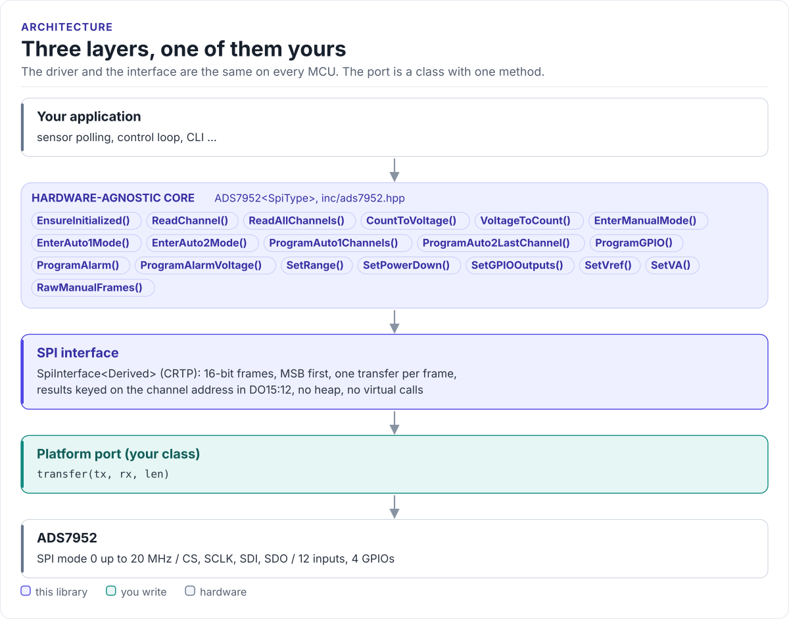
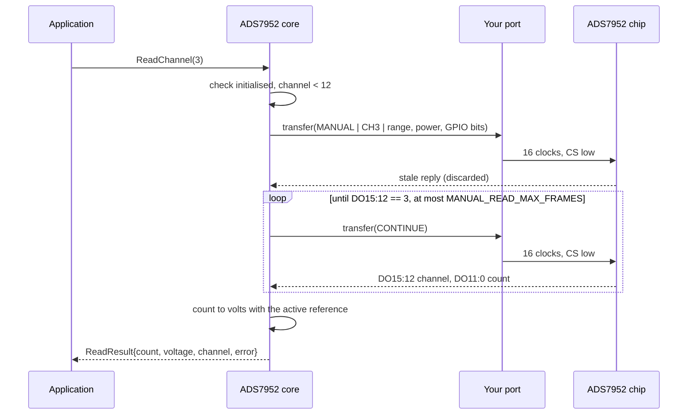

# Architecture

How the driver is put together: three layers, what each owns, and how one call reaches the chip.

<!-- figure: driver-layers -->
<picture>
  <source media="(prefers-color-scheme: dark)" srcset="diagrams/driver-layers.dark.svg">
  
</picture>
<!-- /figure -->

## The three layers

| Layer | Where | Depends on | You change it when |
| --- | --- | --- | --- |
| **Hardware-agnostic core**: `ADS7952<SpiType>` | [`inc/ads7952.hpp`](../inc/ads7952.hpp), [`src/ads7952.ipp`](../src/ads7952.ipp) | The port's `transfer()` | Never, for a new board |
| **SPI interface**: `SpiInterface<Derived>` | [`inc/ads7952_spi_interface.hpp`](../inc/ads7952_spi_interface.hpp) | The port's `transfer()` | Never |
| **Platform port**: your class | Your project | Your SDK | Once per MCU or board ([Porting](porting.md)) |

Everything above the port is the same on ESP32, STM32, a Linux host or the unit-test model. That is how the
[host tests](testing.md) run the real driver code without hardware.

## How one call reaches the chip

## Design choices

- **CRTP, not a virtual base.** The port is a template parameter, so the compiler calls `transfer()` directly and
  can inline it; there is no vtable and no RTTI. The cost is that the driver type names the port:
  `ADS7952<MySpi>`.
- **No heap, no exceptions.** The driver holds a reference to your port and a few bytes of state (mode, range,
  masks, reference voltages). Every call is `noexcept`.
- **Synchronous and imperative.** Each call sends its frames and returns; there is no state machine or background
  task. The driver is not thread-safe: give each chip one owner, or guard calls with a mutex.
- **Address-keyed results.** The chip tags every reply with its channel, so the driver matches on the tag instead
  of trusting a frame count ([Modes and the frame pipeline](modes-and-pipeline.md)).
- **State mirrored in software.** The chip has no readable registers. The driver remembers what it programmed
  (`GetMode()`, `GetRange()`, `GetAuto1ChannelMask()`, `GetAuto2LastChannel()`); after a chip reset or brown-out,
  call `EnsureInitialized(true)` to program it again.

## Source map

| Path | Contents |
| --- | --- |
| `inc/ads7952.hpp` | `ADS7952<SpiType>`: construction, reads, modes, programming, range and power |
| `src/ads7952.ipp` | Template implementation, included at the end of the header |
| `inc/ads7952_spi_interface.hpp` | `SpiInterface<Derived>`, the CRTP base of your port |
| `inc/ads7952_types.hpp` | Enums, `ReadResult`, `ChannelReadings`, `GPIOConfig`, channel-mask helpers |
| `inc/ads7952_registers.hpp` | Command-word fields and program-register layouts (`ads7952::reg`) |
| `inc/ads7952_config.hpp` | Compile-time defaults (`ADS7952_CFG`) |
| `tests/` | Host unit tests, the chip model and the compiled documentation snippets |
| `examples/esp32/` | ESP-IDF applications |
