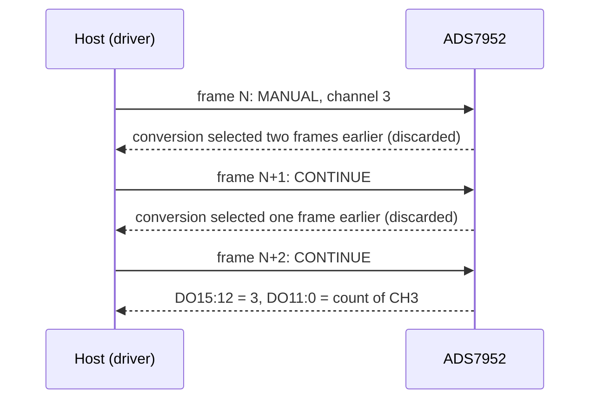

# Hardware

What to connect between your MCU and an ADS7952, with which bus settings, and the board-level traps to avoid.

All values here come from the [ADS79xx datasheet](datasheet/ads7952.pdf) (SLAS605C, revised July 2018). When they
disagree with a board's schematic, the schematic wins for pin numbers.

## Pins

Pin numbers are for the 38-pin TSSOP (DBT). The 32-pin VQFN (RHB) has the same signals except GPIO1 to GPIO3: it
has one GPIO pin, which behaves as GPIO0.

### Host interface

| Signal | Pin | Direction (chip) | Notes |
| --- | --- | --- | --- |
| CS | 31 | in | Active low. Its falling edge samples the input and starts a frame; hold it low for 16 clocks |
| SCLK | 32 | in | Up to 20 MHz |
| SDI | 33 | in | Command word DI15:0, sampled on the rising edge of SCLK |
| SDO | 34 | out | Reply DO15:0, changes on the falling edge of SCLK; 3-state while CS is high |
| +VBD | 36 | supply | Digital I/O supply, 1.7 V to +VA; sets the logic levels |
| BDGND | 35 | ground | Digital ground |

### Analog

| Signal | Pin | Direction (chip) | Notes |
| --- | --- | --- | --- |
| CH0 ... CH7 | 28 ... 21 | in | CH0 is pin 28, CH7 is pin 21 |
| CH8 ... CH11 | 18 ... 15 | in | CH8 is pin 18, CH11 is pin 15 |
| MXO | 7 | out | Multiplexer output: connect to AINP, directly or through a buffer |
| AINP | 8 | in | Converter input |
| AINM | 9 | in | Converter input ground: connect to AGND |
| REFP | 4 | in | External reference, 2.0 V to 3.0 V (2.5 V nominal) |
| REFM | 3 | in | Reference ground: connect to AGND |
| +VA | 5, 29 | supply | Analog supply, 2.7 V to 5.25 V |
| AGND | 6, 10, 19, 20, 30 | ground | Analog ground |
| NC | 11, 12, 13, 14 | | Not connected inside: connect them to ground, do not leave them floating |

### GPIOs

The four GPIOs are general-purpose inputs or outputs after reset. `ProgramGPIO()` can give three of them a fixed
function; the outputs are active high.

| Pin | Name | Alternative function |
| --- | --- | --- |
| 37 | GPIO0 | High alarm, or combined high-or-low alarm output |
| 38 | GPIO1 | Low alarm output |
| 1 | GPIO2 | Range input: high selects 0 to 2 × VREF, low 0 to VREF |
| 2 | GPIO3 | Power-down input, active low |

## Bus settings

| Setting | Value |
| --- | --- |
| Mode | SPI mode 0 (CPOL = 0, CPHA = 0), MSB first |
| Speed | Up to 20 MHz (fSCLK, any +VBD); the ESP32 examples use 4 MHz |
| Frame | 16 bits: command DI15:0 in, reply DO15:0 out, full duplex |
| Chip select | Low for exactly one frame, then high for at least tw1 = 20 ns |
| Reply | DO15:12 channel address (or GPIO input levels), DO11:0 the 12-bit count |
| Latency | A channel selected in frame N is converted in frame N + 2 |

The driver sends every frame as one two-byte `transfer()`, so your port only has to keep CS low across both bytes
and release it afterwards. [Modes and the frame pipeline](modes-and-pipeline.md) explains the latency and how the
driver deals with it.

### Timing

Minimums and maximums from the timing requirements (Section 7.9, 50 pF load), at the three I/O supply ranges.

| Parameter | Symbol | +VBD = 1.8 V | +VBD = 3 V | +VBD = 5 V |
| --- | --- | --- | --- | --- |
| CS low to first SCLK rising edge (min) | tsu1 | 8 ns | 6 ns | 4 ns |
| CS low to DO15 valid (max) | td1 | 38 ns | 27 ns | 17 ns |
| SCLK falling to next SDO bit (max) | td2 | 35 ns | 27 ns | 17 ns |
| SDI setup to SCLK rising (min) | tsu2 | 2 ns | 3 ns | 4 ns |
| SDI hold after SCLK rising (min) | th2 | 12 ns | 10 ns | 6 ns |
| CS high time (min) | tw1 | 20 ns | 20 ns | 20 ns |
| SCLK high and low time (min) | twh, twl | 20 ns | 20 ns | 20 ns |
| Quiet time before next conversion (min) | tq | 40 ns | 40 ns | 40 ns |

The conversion takes 16 SCLK cycles (800 ns at 20 MHz). The input is acquired from the 14th SCLK of one frame to
the CS falling edge of the next, at least 325 ns; at slow clocks that window grows, which is why a high source
impedance shows up as channel-to-channel crosstalk at high SCLK rates.

## Power

| Supply | Range | Notes |
| --- | --- | --- |
| +VA (analog) | 2.7 V to 5.25 V | 1.8 mA typical at 1 MSPS with +VA ≤ 3.6 V; 2.3 mA typical, 3 mA maximum with +VA ≥ 4.7 V |
| +VBD (digital I/O) | 1.7 V to +VA | Match your MCU's I/O voltage |
| VREF (REFP) | 2.0 V to 3.0 V | 100 kΩ input resistance at 1 MSPS; noise rises below about 2.4 V |
| Analog inputs | −0.3 V to +VA + 0.3 V | Absolute maximum; the measurable span is 0 to VREF or 0 to 2 × VREF |

Power-down (`SetPowerDown()` or GPIO3 low) brings the supply current to 1 µA typical. The chip is ready 1 µs after
power-up, and the first conversion after power-up or reset is invalid: `EnsureInitialized()` discards it.

!!! warning "The 2 × VREF range needs 2 × VREF ≤ +VA"
    With a 2.5 V reference, `Range::TwoVref` measures 0 V to 5 V only when +VA is at least 5 V. The driver does not
    check this: on a 3.3 V supply the top of the range is clipped by the supply and the counts above it are wrong.

## Board-level traps

- **MXO is not connected to AINP inside the chip.** Short them on the board (TI's reference design does), or put
  your buffer or filter between them.
- **Source impedance.** When the multiplexer switches, the 15 pF sampling capacitor dumps the previous channel's
  charge onto the new one. TI recommends 50 Ω or less with MXO shorted to AINP, or a capacitor of about 150 pF at
  each input.
- **The reference sets the accuracy.** Decouple REFP with 10 µF next to the pin (the datasheet's application
  circuit uses a REF5025).
- **Ground the NC pins** (11 to 14 on the TSSOP).

## Example wiring

The [ESP32 examples](examples.md) run on an ESP32-S3; their pins are in
[`esp32_ads7952_test_config.hpp`](../examples/esp32/main/esp32_ads7952_test_config.hpp).

| ADS7952 | ESP32-S3 | Note |
| --- | --- | --- |
| SCLK | GPIO12 | SPI2 (IOMUX pins) |
| SDI | GPIO11 | MOSI |
| SDO | GPIO13 | MISO |
| CS | GPIO10 | Driven by the SPI peripheral |

## Reference documents

| Document | What it is for |
| --- | --- |
| [ADS79xx datasheet (SLAS605C)](datasheet/ads7952.pdf) | Pins, electrical limits, timing, mode and program registers |
| [ADS7952 product page](https://www.ti.com/product/ADS7952) | Current datasheet revision, packages, evaluation hardware |
