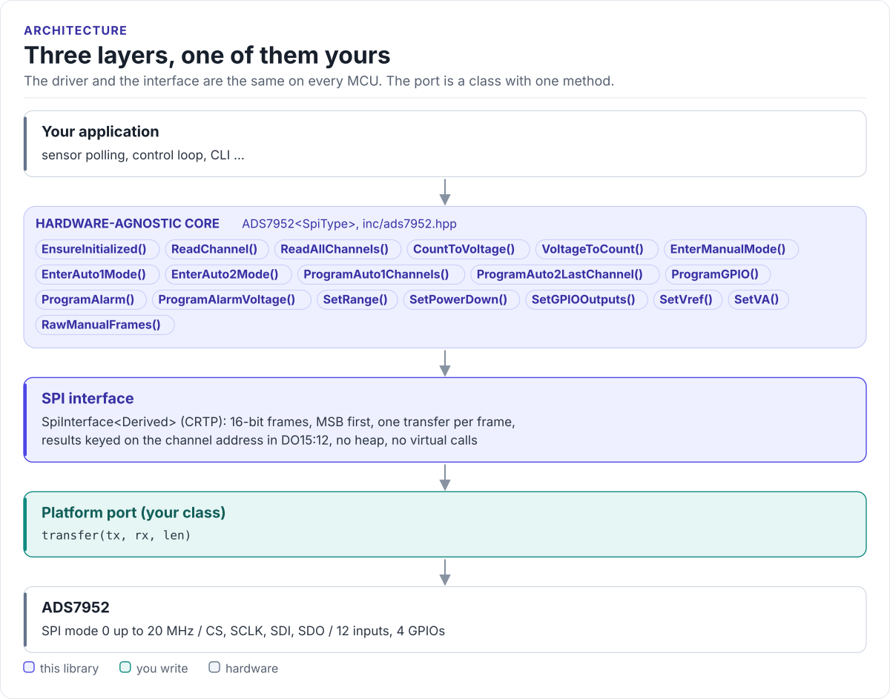

# Porting

Run the driver on a new MCU by writing one class: the SPI interface, with one method.

The driver never calls your SDK directly. It calls `transfer()` on a class you derive from
`ads7952::SpiInterface<Self>` (in [`inc/ads7952_spi_interface.hpp`](../inc/ads7952_spi_interface.hpp)). The base
class uses CRTP: the call is resolved at compile time, so there are no virtual functions, no vtable and nothing to
allocate.

<!-- figure: driver-layers -->
<picture>
  <source media="(prefers-color-scheme: dark)" srcset="diagrams/driver-layers.dark.svg">
  
</picture>
<!-- /figure -->

## What you implement

| Method | Contract |
| --- | --- |
| `bool transfer(const uint8_t* tx, uint8_t* rx, std::size_t len)` | Assert CS, clock `len` bytes out of `tx` while reading `len` bytes into `rx`, release CS. Return `true` when the frame went out, `false` on a bus error. The driver always passes `len = 2` and both buffers |

There is nothing else: no GPIOs, no delays, no logging. The chip has no reset or data-ready pin, and its timing
is set by SCLK and CS.

## The port

```cpp title="my_spi.hpp"
--8<-- "tests/docs/my_spi.hpp:port"
```

Rules the transfer must follow:

- **SPI mode 0**, MSB first, at most 20 MHz.
- **One frame per call.** CS goes low before the first clock and high after the 16th; never split the two bytes
  into separate CS cycles, never merge two calls into one. The chip samples its input on the CS falling edge.
- **CS high for at least 20 ns** between frames (t<sub>w1</sub>). Most SPI peripherals give far more.
- **Byte order as given.** `tx[0]` is DI15:8 and goes first; `rx[0]` receives DO15:8.

## Bus errors

Return `false` from `transfer()` when your SDK reports a failure. The driver stops the call that sent the frame:
`EnsureInitialized()`, the `Enter...Mode()`, `Program...()` and `Set...()` calls return `false`, `ReadChannel()` and
`ReadAllChannels()` return `Error::SpiError`, and `RawManualFrames()` returns the number of frames that got through.
The driver's mirrored state (mode, sequence masks, range, power-down, GPIO outputs) changes only when the frames
that change it went out.

Return a `bool`, not your SDK's status code: the driver rejects any other return type at compile time, so an
`esp_err_t` (where 0 is success) cannot be read as `false`. A port written for the earlier contract, with a `void`
`transfer()`, still compiles; the driver treats it as never failing.

## Reference implementation

The ESP32 examples use [`esp32_ads7952_bus.hpp`](../examples/esp32/main/esp32_ads7952_bus.hpp): an ESP-IDF
`spi_master` device in mode 0 with hardware CS, one `spi_device_transmit()` per frame. Start from it for any
ESP-IDF target.

## Check your port

1. Build it: the port on this page is compiled by the host CI from
   [`tests/docs/my_spi.hpp`](../tests/docs/my_spi.hpp), with the driver instantiated over it.
2. Call `EnsureInitialized()`, then `RawManualFrames(5, words, 4)`: `words[2] >> 12` must be 5. If the address
   never matches, look at the bus with a logic analyser (mode, CS framing, byte order).
3. Put a known voltage on one input and compare `ReadChannel()` with a meter. Use the measured REFP with
   `SetVref()`.
4. Read two channels with very different voltages in turn: if the second reads close to the first, the source
   impedance is too high for your SCLK rate ([Hardware](hardware.md#board-level-traps)).

## Threads

The driver is not thread-safe. Give each ADS7952 one owner task, or guard every call on a driver object (and its
port) with one mutex. If the SPI bus is shared, your SDK's bus lock must cover a whole `transfer()` call.
